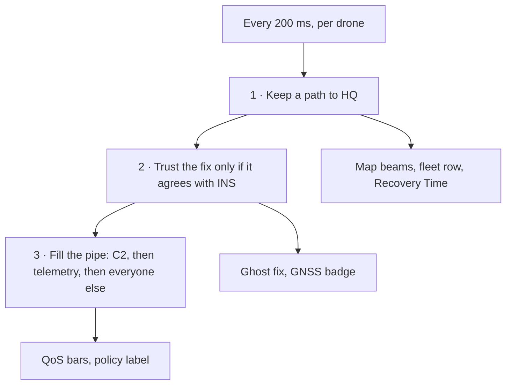
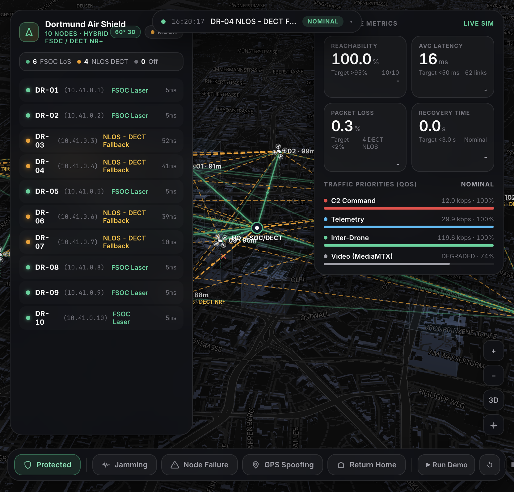
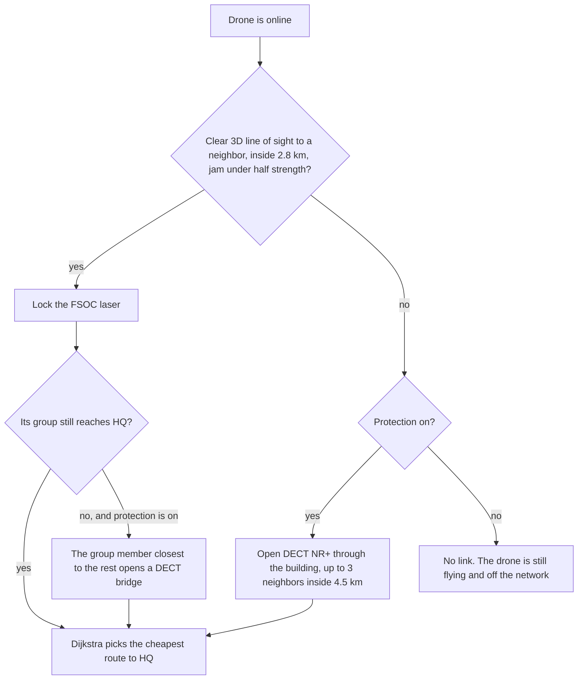
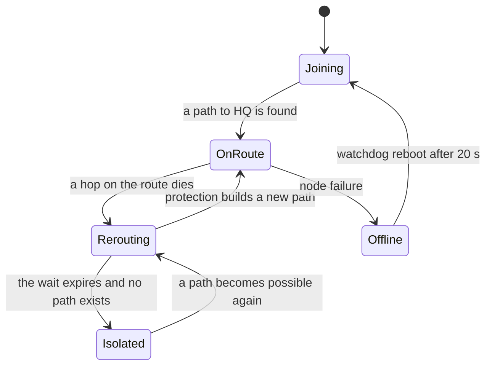
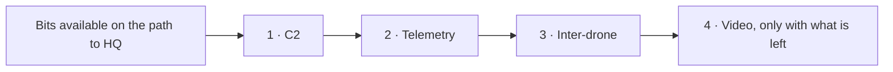

# Dortmund Air Shield

**A hybrid FSOC laser and DECT NR+ mesh, flown over a 3D Dortmund.**

Ten drones. One control center at the Reinoldikirche. A city that keeps getting in the way. The dashboard is a single file, `index.html`, with no build step. Open it and the mission is already running. A Python backend can take over the telemetry; until it does, the built-in simulation flies the whole thing.

DO-DATA-HACKATHON 2026 · Morpheus Logistik · Challenge 02: OFF-GRID AIR

**Live** · <https://soulnassim.github.io/dortmund-air-shield/>

---

## The problem

A drone over a European city center goes quiet in three ways, and they stack. The hackathon question is what the fleet does in the minute after that happens.

### The building eats the laser

Free-space optical is the fast link: a laser, gigabit-class, a few milliseconds. A laser stops at the first solid object. Dortmund Innenstadt is a canyon. The Dortmunder U-Tower, the Hbf tower, Sparkasse, Ellipson, the RWE block, the Stadthaus, Westfalentower, Ostwall — several of them are taller than a drone cruising at 80–100 m.

A node behind the U-Tower still has a perfect radio day and a dead optical path to HQ. The beam hits concrete. Video, telemetry and command die on the same face of the building. A mesh that only draws straight lines on a flat map never shows you why.

### The jammer eats the radio that survives the building

The link that can pass a wall is the link a jammer is built to kill. Sector West, centered on the U-Tower, lifts the noise floor on 2.4 GHz, 5.8 GHz and GNSS L1. Inside the circle the laser is already contested and the satellite fix is gone. A fleet with one band leaves the map the moment it crosses that line, still airborne, still on its orbit, unreachable.

### The position can be a lie, and the relay can just die

Spoofing does not cut the radio. It moves the fix, a few metres a second, until the autopilot is flying a place the airframe is not. Separately, a relay can drop: heartbeat timeout, power bus. Every route that used it is gone. The drones on the far side can still see each other and have no way home.

The number that matters is whether HQ can still reach every node after all three have happened, and how many seconds that took.

---

## What the mesh does

Every 200 ms, each drone tries three things, in this order.

1. **Keep a path to HQ.**
2. **Keep a position it can trust.**
3. **Spend the pipe on command-and-control first.**

The buttons along the bottom only start the attack. The mesh answers by itself. **Protected / Unprotected** (`P`) turns those answers off, so the same attack can be shown both ways.



| | Protected | Unprotected |
|---|---|---|
| Line of sight | A blocked laser becomes a DECT NR+ hop through the building | The laser stops on the facade. Nothing replaces it |
| Jamming | The node leaves FSOC and stays on the DECT mesh | The node keeps asking for a beam that is gone |
| Position | GNSS is rejected once it disagrees with INS by 60 m. The airframe stays on the real track | The autopilot flies the fake fix |
| Routing | A broken route is rebuilt. A group cut off from HQ gets a DECT bridge | The drone waits for the original hop to come back |
| Traffic | C2, then telemetry, then inter-drone, then video. C2 is sent three times. Video is shed under attack | Every class shares the pipe. Video competes with C2 |

---

## The visualisation

The city is the interface. MapLibre draws Dortmund at a 60° pitch, bearing −18°, centered on `51.5136° N, 7.4653° E`. OpenStreetMap buildings extrude from real heights. Eight landmark volumes — the U-Tower among them — are also drawn as the exact blocks the line-of-sight raycast uses, so the thing that breaks the laser is the thing you are looking at.

Drones sit at their real altitude, with a drop-line down to a shadow on the street. HQ is the optical mast over the Reinoldikirche.



*Nominal hybrid mesh. Green beams are clear line of sight. Amber dashes are DECT NR+ where a building already ate the laser. The fleet list and the scorecard float over the city.*

| Region | What it shows |
|---|---|
| Map | Pitched Dortmund. Drones are quadcopters labelled with id and altitude. HQ is the ring on the mast. |
| Fleet, left | One row per drone: status dot, id, mesh IP `10.41.0.x`, band, latency. Click a row to expand altitude, speed, battery, hops, 3D line of sight and GNSS, and to pin that drone. |
| Scorecard, right | Reachability, latency, packet loss, recovery time, each with a sparkline. Under them, four traffic bars. |
| Toast, top | The latest log line. Click it for the full event log. The pill is the threat level: NOMINAL, ELEVATED, CRITICAL. |
| Dock, bottom | Protection, the four injections, demo, reset, simulation speed. |

Scroll to zoom. Drag to pan. Right-drag or Ctrl-drag to orbit and change pitch. `3D` snaps between 60° and a shallower view. `⌖` flies back to the Innenstadt.

Click a drone, click it again to dismiss, **Shift+click** to move the threat zone. Keys: `P` protection · `J` jamming · `G` GPS spoofing · `F` node failure · `R` return home · `Esc` deselect.

On a narrow screen the same panels collapse: fleet becomes a chip strip, the scorecard becomes a sheet, the dock scrolls sideways. The map stays full-bleed.

### How to read the air

| You see | It means |
|---|---|
| Solid green beam | FSOC laser on a clear 3D line of sight |
| Green stub ending in a red ✕ | The laser reached a building face and stopped. The label on the block is the occluder |
| Dashed amber line through a building | DECT NR+ fallback. The path is allowed to be non-line-of-sight |
| `NLOS · DECT NR+` next to a drone | That node's route home is on the fallback radio |
| Amber wireframe on the U-Tower | The landmark volume used by the raycast, drawn so the blocker is obvious |
| Pulsing amber dot | Fallback, spoofed fix, or a route still rebuilding |
| Pulsing red dot | GNSS lost, isolated, or no radio at all |
| Amber ghost on a dashed tether | The fake GNSS fix. The airframe stays on the real track while protection is on |
| Red disc, Sector West | Jamming, centered on the U-Tower |
| Wider amber ring | Spoofing reach, 1.5× the jam zone |

---

## The two links

DECT NR+ here is the second radio **inside the simulation**. It is not a hardware modem and the Python backend does not speak it. The backend sends positions and events. The dashboard decides the band, by raycasting every candidate hop against the building volumes.

| | FSOC laser | DECT NR+ 1.9 GHz |
|---|---|---|
| Role | Primary, when the 3D path is clear | Automatic fallback through buildings, jamming and partitions |
| Needs line of sight | yes — the beam dies on the first block it hits | no — the hop is drawn through the block |
| Reach | 2.8 km | 4.5 km |
| Capacity | up to 1 Gbps, scaled by link quality | 4.8 Mbps |
| Latency | a few milliseconds | tens of milliseconds, higher inside the jam |
| Carries full video | yes | video is shed; C2, telemetry and inter-drone still fit |
| On the map | solid green | dashed amber |



Routing cost is latency plus packet loss weighted hard, with an extra penalty on every DECT hop. A clear laser wins whenever it still reaches HQ. DECT is taken when it is the path that still works. A route already in use is kept until a new one is clearly cheaper, so the mesh does not flap every time a rotor crosses a roofline.

---

## Four ways the city fights back

### Jamming — `J`

A transmitter in **Sector West · U-Tower** (620 m, full strength inside, gone at 1.35×) takes 2.4 / 5.8 GHz and GNSS L1. Drones whose orbits cross the circle lose the laser and the satellite fix.

| | Protected | Unprotected |
|---|---|---|
| Radio | The hop turns dashed amber. The row reads `NLOS - DECT Fallback` | The lines vanish. The row reads `Isolated` |
| GNSS | Fix marked lost. Navigation continues on inertial dead-reckoning | Same loss of fix, and no second radio to report it on |
| Video | Shed so C2 stays full. Policy label moves to anti-jam | Video keeps asking for a pipe that is already gone |
| Scorecard | Reachability holds. Latency and loss rise, because the surviving path is the slower one | Reachability drops by about one tenth per drone that loses its links |

### GPS spoofing — `G`

The radio stays up. Every drone inside 1.5× the zone is fed a counterfeit L1 fix that drifts at about 7 m/s. The cheat is an amber ghost tethered to the airframe.

| | Protected | Unprotected |
|---|---|---|
| Under 60 m | Badge says spoofed. The drone still flies its real orbit | The autopilot is already steering toward the fake fix |
| Past 60 m | The fix disagrees with INS and is rejected. The airframe stays on the real track | The drone leaves its orbit and the drift keeps growing |
| After you turn it off | The offset decays and the fix is trusted again | The drone has to fly back to the orbit it left |

### Node failure — `F`

Two random drones die: heartbeat timeout, power bus. They stop, descend, and reboot themselves after 20 s. This is a different event from falling off the network. The node is actually offline.

Everyone who was routing through them loses that hop. Protected, Dijkstra installs a new route. The wait is about **450 ms plus 220 ms per hop**, plus **900 ms** when the new path uses DECT, plus a little jitter. That measured wait is the **Recovery Time** number. Unprotected, no new route is searched. Those drones stay broken until the dead relay finishes rebooting.

If a whole group still meshes locally and has lost every path to HQ, protection picks the member closest to the rest of the network and opens a DECT bridge. The others ride that bridge home.

### Return home — `R`

The one response that waits for the operator. The mesh will not fly the fleet home by itself. Pressing it pulls every drone toward HQ, sheds video, and marks C2 as emergency. Press again and the fleet returns to its orbits.

---

## When a drone falls off

Falling off means the drone is still airborne and still flying, and it has no usable path to HQ. Command, telemetry, inter-drone traffic and video from that drone all deliver nothing.



What you see, in order:

1. The green beams disappear. With protection off, no amber DECT lines replace them. The log says the optical and DECT links are gone.
2. For about a second the drone is **rerouting**. Route empty, latency a dash.
3. The wait expires and the drone is **isolated**. A pulsing red dot replaces its links. The flight code keeps the mission orbit. With spoofing on and protection off, it keeps steering toward the fake fix.
4. It still counts as online, so the fleet header does not move it to Off. It counts as unreachable, so reachability falls and packet loss jumps.
5. Average latency can look healthier after the drop. Only drones that still have a route are in that average. Read reachability when nodes have gone isolated.

It comes back when a path to HQ exists again. Protected, that is the moment a DECT or FSOC route appears, and the heal time is recorded. Unprotected, it happens when the original links return: jamming off, or the failed relay rebooted. Switching the shield back to Protected during the attack pulls isolated drones in within a few seconds.

---

## The four numbers

| Number | Target | What moves it |
|---|---|---|
| Reachability | > 95 % | Share of online drones that currently have a route to HQ. One isolated drone is about −10 % |
| Avg latency | < 50 ms | Round trip of the drones that still have a route. DECT pushes this up. Isolated drones are left out |
| Packet loss | < 2 % | Traffic that does not arrive. An isolated drone counts as a total loss |
| Recovery time | < 3 s | Seconds the mesh took to install a new route after one broke. During a heal it shows the wait so far |

White is inside the target. Amber, then red, means the target has been crossed. The small label under each number says whether the figure is from the live simulation, a WebSocket feed, or a metric override.

---

## Traffic, in order

Each drone's path is filled strictly. C2 is about 1.2 kbps and is retried three times, so it stays near full on a lossy hop. Telemetry is about 3 kbps. Inter-drone is about 12 kbps. Video wants 3.5 Mbps.



On DECT the pipe is 4.8 Mbps, so video is the first thing shed and the first three still fit. During jamming or return-home, video that is still on the laser is cut back on purpose. Unprotected, the order is removed: all four classes take a proportional share, video included, and C2 gets no retries.

---

## Seventy seconds

`?demo=1` runs the attack on its own. Add `?protect=0` for the same script with the defenses off.

| Time | What happens |
|---|---|
| 0.5 s | Hybrid mesh over 3D Dortmund, lasers where the sky is clear |
| 5 s | Jammer on in Sector West, on the U-Tower |
| 16 s | Spoofer joins the jammer |
| 28 s | Two relay drones fail |
| 42 s | Operator sends return home |
| 62 s | Threat cleared, lasers come back, fleet returns to mission |
| 70 s | Scenario ends |

---

## Run

```bash
python3 -m http.server 8000   # → http://localhost:8000
```

| URL | What you get |
|---|---|
| `?demo=1` | 70 s scripted attack, then all-clear |
| `?protect=0` | start with every automatic defense off |
| `?protect=0&demo=1` | the scripted attack with no protection — open it beside `?demo=1` |
| `?ws=ws://localhost:8765` | connect to the Python backend on load |
| `?poll=http://localhost:5000/state&interval=1000` | poll a REST endpoint instead |

---

## Backend

```bash
pip install websockets
python backend/mock_backend.py
# open index.html?ws=ws://localhost:8765
```

`backend/mock_backend.py` streams positions at 2 Hz. Replace `telemetry()` with real data. Click the **MOCK** pill to reveal the WebSocket field.

Data from the backend is authoritative for 5 s per drone. After that the built-in simulation takes over again, so a partial feed works: positions only, for example. The dashboard still raycasts line of sight and chooses FSOC or DECT unless you override the links.

### Backend → dashboard

```jsonc
{"type": "drones", "data": [{"id": "DR-07", "lat": 51.514, "lon": 7.454, "alt": 78, "battery": 81,
                             "status": "ONLINE|OFFLINE|RTH", "gnss": "OK|LOST|SPOOFED", "band": "FSOC|DECT"}]}
{"type": "event",   "data": {"type": "JAMMING|SPOOFING|NODE_FAILURE|NODE_RESTORE|RTH|PROTECTION|ZONE|RESET",
                             "active": true, "lat": 51.5132, "lon": 7.4545, "radius_m": 620, "ids": ["DR-04"]}}
{"type": "metrics", "data": {"reachability": 97.2, "latency_ms": 23, "packet_loss": 1.1, "recovery_s": 1.4}}
{"type": "links",   "data": [{"a": "DR-01", "b": "HQ", "band": "FSOC", "quality": 0.82}]}
{"type": "log",     "data": {"level": "INFO|OK|WARN|CRIT|NET", "msg": "text"}}
{"type": "state_request"}
```

A bare array of drones, or a single drone object with an `id`, is also accepted. Unknown drone IDs are added to the fleet. `PROTECTION` with `"active": false` is the same switch as the shield. Older band strings (`2.4GHz`, `868MHz`, `LORA`) still map: anything that looks like a sub-GHz fallback becomes DECT, everything else becomes FSOC.

### Dashboard → backend

```jsonc
{"type": "hello", "client": "dortmund-air-shield", "version": "2.0.0", "fleet": ["DR-01"]}
{"type": "command", "action": "SET_JAMMING|SET_SPOOFING|FORCE_NODE_FAILURE|SAFE_RETURN_HOME|SET_PROTECTION|MOVE_ZONE|RESET", "value": true, "ts": 0}
{"type": "state", "data": { }}
```

### JavaScript

```js
window.updateDroneData([{ id: 'DR-07', lat: 51.514, lon: 7.454, alt: 78 }]);
AirShield.injectEvent({ type: 'JAMMING', active: true });
AirShield.injectEvent({ type: 'PROTECTION', active: false });
AirShield.updateMetrics({ reachability: 99 });
AirShield.updateLinks([{ a: 'DR-01', b: 'HQ', band: 'DECT', quality: 0.4 }]);
AirShield.connect('ws://localhost:8765');
AirShield.poll('http://localhost:5000/state', 1000);
AirShield.onCommand(cmd => console.log(cmd));
AirShield.getState();
```

---

## Constants

| Constant | Value |
|---|---|
| Fleet | DR-01 … DR-10, plus HQ at the Reinoldikirche, 51.5136° N, 7.4653° E, 65 m |
| Mesh addresses | `10.41.0.1` … `10.41.0.10` |
| Camera | zoom 14.35, pitch 60°, bearing −18°, Dortmund center |
| Occluders | U-Tower 155 m, Hbf tower, Sparkasse, Ellipson, RWE, Stadthaus, Westfalentower, Ostwall |
| Jam zone | 51.5132° N, 7.4545° E, radius 620 m, Sector West · U-Tower |
| Jam fringe | full strength to the radius, zero at 1.35× |
| GNSS lost | jam strength above 0.55 |
| Spoof radius | 1.5× the jam zone, drift ~7 m/s |
| GNSS rejected | offset greater than 60 m against INS |
| FSOC | 2.8 km, up to 1 Gbps, requires a clear 3D ray |
| DECT NR+ | 4.5 km, 4.8 Mbps, opened when the ray hits a building, the jam is above 0.5, or a group has lost HQ |
| Rebuild wait | 450 ms + 220 ms/hop + 900 ms if the new path is DECT |
| Failed node | back after 20 s |
| Network tick | every 200 ms |
