# Dortmund Air Shield — Off-Grid Air Mission Control

Simulation dashboard for **DO-DATA-HACKATHON 2026 · Morpheus Logistik · Challenge 02: OFF-GRID AIR**.

Ten drones fly a mesh over Dortmund and have to keep talking to the control center when someone takes the fast radio and the GPS away. The dashboard is one file, `index.html`, with no build step. A Python backend can drive it over WebSocket, and without a backend the built-in simulation runs the whole mission.

The thing the demo is scoring is **protection**: every 200 ms each drone tries to keep a path to HQ, keep a position it can trust, and spend whatever bandwidth is left on command-and-control first. The buttons along the bottom only start the attack. The mesh answers by itself. A **Protected / Unprotected** switch turns those answers off so the same attack can be shown both ways.

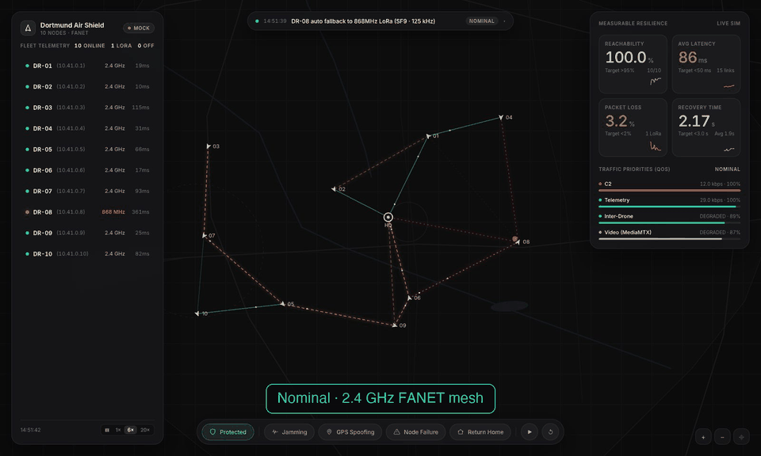

*Jamming, then spoofing, then two drones shot down, all with protection on. Then protection is switched off and back on in the middle of the attack.*

## The screen

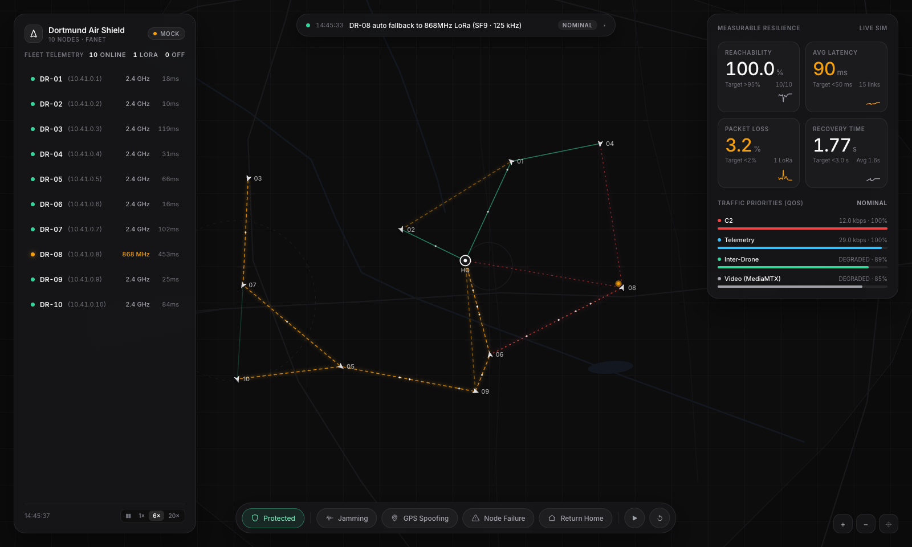

| Region | What it shows |
|---|---|
| Map | Dortmund as a dark grid. Drones are small silver chevrons labelled `01`–`10`. HQ is the ring in the middle. |
| Fleet, left | One row per drone: status dot, id, mesh IP `10.41.0.x`, band, latency. Click a row to expand altitude, speed, battery, hops and GNSS, and to highlight that drone. |
| Scorecard, right | Four big numbers plus a sparkline, then four thin bars for traffic priority. |
| Toast, top | The latest log line. Click it to open the full event log. The pill on the right is the threat level: NOMINAL, ELEVATED, CRITICAL. |
| Dock, bottom | Protection, then the four injections, then demo and reset. |

| Click a drone | Click the toast |
|---|---|
| 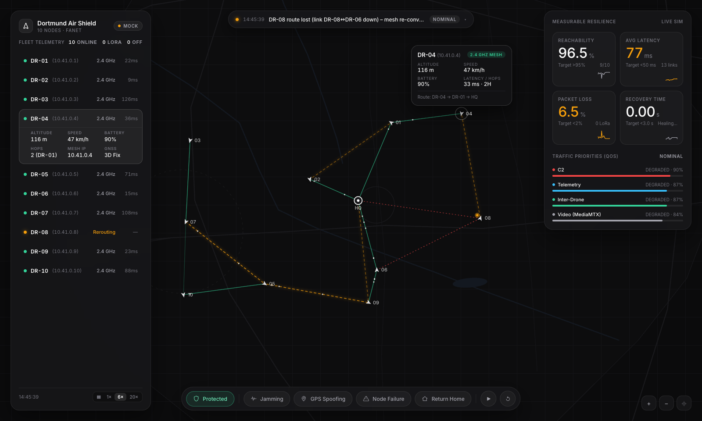 | 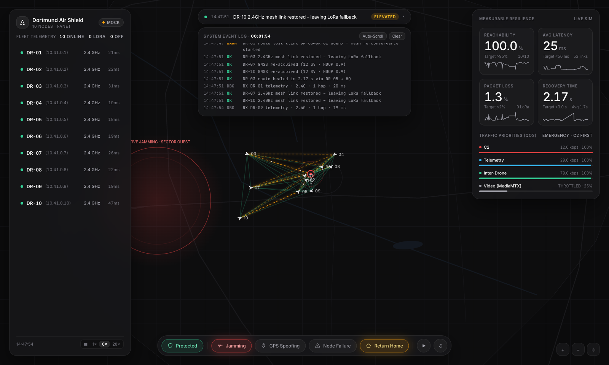 |
| The fleet row expands and a card follows the drone on the map | The full event log, with auto-scroll and clear |

Map controls: scroll to zoom, drag to pan, click a drone, click it again to dismiss, **Shift+click** to move the threat zone. Keys: `P` protection · `J` jamming · `G` GPS spoofing · `F` node failure · `R` return home · `Esc` deselect.

### How to read the map

| You see | It means |
|---|---|
| Solid mint line | Healthy 2.4 GHz hop on a route to HQ |
| Faint mint line | 2.4 GHz hop that exists but is not carrying a route |
| Dashed amber line | Degraded hop, or a route that was just rebuilt |
| Dotted red line | 868 MHz LoRa fallback |
| Silver chevron `07` | Drone, pointing along its heading |
| Pulsing amber dot | Fallback, spoofed, or rerouting |
| Pulsing red dot | GNSS lost, isolated, or no radio |
| Amber ghost with a dashed tether | The fake GNSS fix. The chevron stays on the real track while protection is on |
| Red disc, west of the city | Jamming zone, Sector Ouest, 2.2 km across |
| Larger amber ring | Spoofing reach, 1.5× the jam zone |

## Run

Live demo: <https://soulnassim.github.io/dortmund-air-shield/>

```bash
python3 -m http.server 8000   # → http://localhost:8000
```

| URL | What you get |
|---|---|
| `?demo=1` | 70 s scripted attack, then all-clear |
| `?protect=0` | start with every automatic defense off |
| `?protect=0&demo=1` | the scripted attack with no protection — open beside `?demo=1` |
| `?ws=ws://localhost:8765` | connect to the Python backend on load |
| `?poll=http://localhost:5000/state&interval=1000` | poll a REST endpoint instead |

## What protection does

Protection is on when you open the page. The shield pill in the dock reads **Protected** and glows mint. Press it, or `P`, and it reads **Unprotected** and glows red. The same four defenses switch together.

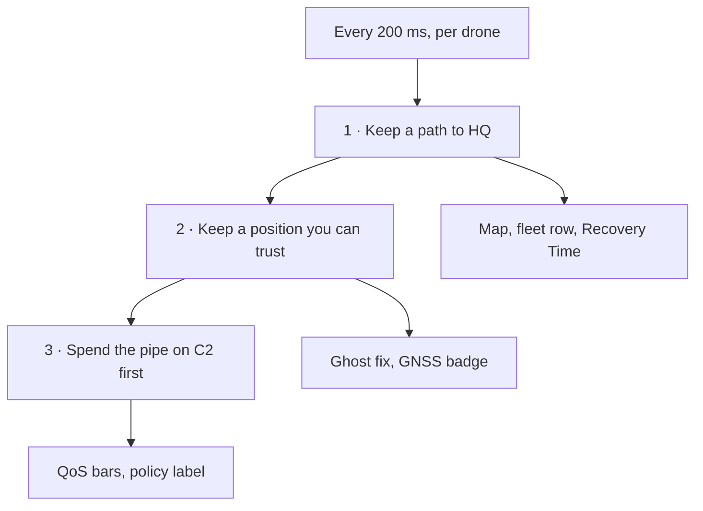

| Defense | Protected | Unprotected |
|---|---|---|
| Radio | Jammed drone drops 2.4 GHz and opens 868 MHz LoRa | Jammed drone keeps asking for 2.4 GHz and falls off |
| Position | GNSS is rejected once it disagrees with INS by 60 m. The drone stays on its real track | The autopilot trusts the fake fix and flies off course |
| Routing | A broken route is rebuilt around the failure. A group cut off from HQ gets a LoRa bridge | The drone waits forever for the original route to come back |
| Traffic | C2, then telemetry, then inter-drone, then video. C2 is sent three times. Video is shed under attack | Every class shares the pipe in proportion. Video competes with C2. No retries |

Turning protection back on in the middle of an attack makes the mesh build the missing routes. In a test that took a few seconds and brought reachability from 50 % back to 99.8 %.

## The two radios

LoRa here is a second radio **inside the simulation**, not a hardware modem and not something the Python backend speaks. The backend sends positions and events. The dashboard decides the band.

| | 2.4 GHz mesh | 868 MHz LoRa |
|---|---|---|
| Role | Primary | Automatic fallback |
| Reach | 4 km, quality `1 − (d / 4 km)³` | 9 km |
| Capacity | up to 54 Mbps, scaled by link quality | 5.5 kbps |
| Latency | a few milliseconds | ~140–300 ms per hop |
| Carries video | yes | no — video is dropped |
| On the map | mint | dotted red |

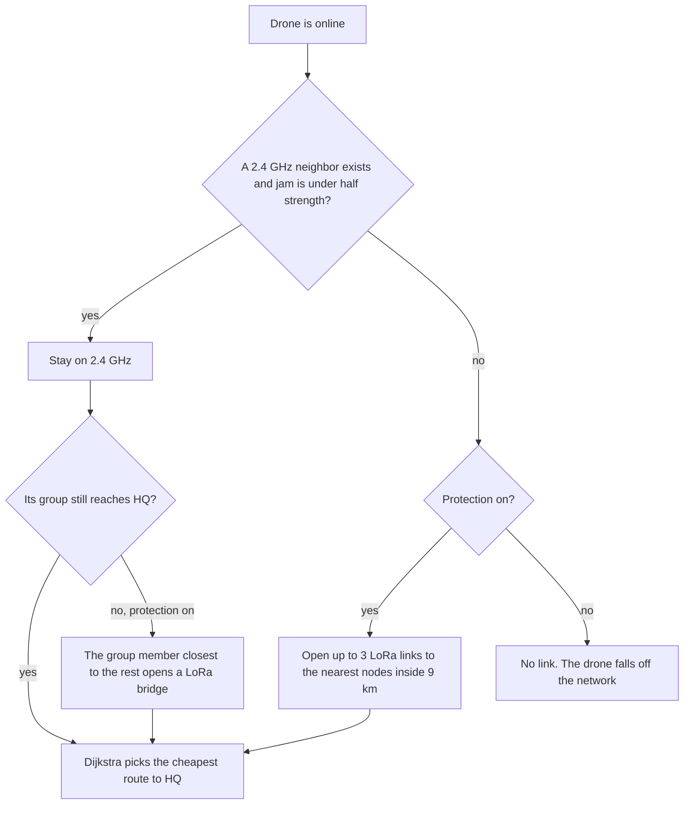

Routing cost is `latency + packet-loss × 400`, plus 120 extra on every LoRa hop. A healthy 2.4 GHz path wins whenever it still reaches HQ. LoRa is taken only when it is the path that still works. A route already in use is kept until a new one is clearly better (under 72 % of the current cost), so the mesh does not flap.

## The four injections

### Jamming — `J`

A transmitter in **Sector Ouest** (west Dortmund, 2.2 km radius) wipes 2.4 GHz and the GNSS L1 signal. Strength is full inside the circle and fades to nothing at 1.35× the radius. DR-07 and DR-10 fly through it on their normal orbits.

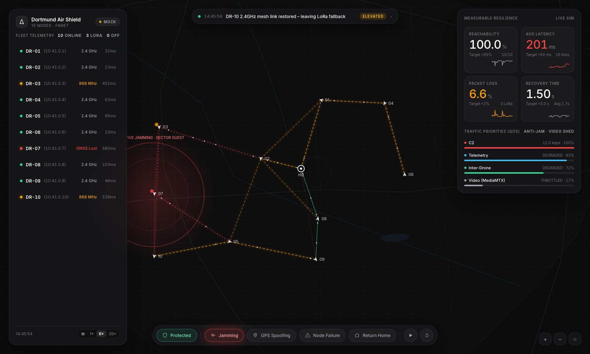

*Protected. Every drone in or near the zone is on 868 MHz (dotted red lines), reachability holds at 100 %, latency rises to about 250 ms, and video is shed to 15 % so C2 keeps 100 %.*

| | Protected | Unprotected |
|---|---|---|
| Radio | Hops inside the zone turn dotted red. The fleet row reads `868 MHz` | The lines vanish. The row reads `Isolated` and latency becomes a dash |
| GNSS | Fix marked lost. The drone navigates on inertial dead-reckoning | Same loss of fix, and no second radio to report it on |
| Video | Cut to a quarter on 2.4 GHz, dropped entirely on LoRa. Policy label: `ANTI-JAM · VIDEO SHED` | Video keeps asking for its full share of a pipe that is already gone |
| Scorecard | Reachability stays high. Latency and loss go up, because the surviving path is slow | Reachability drops by about 10 % per drone that loses its links |

### GPS spoofing — `G`

Does not cut the radio. Every drone inside 1.5× the zone radius is fed a fake fix that drifts at about 7 m/s. The cheat is drawn as an amber ghost tethered to the chevron.

| Protected | Unprotected |
|---|---|
| 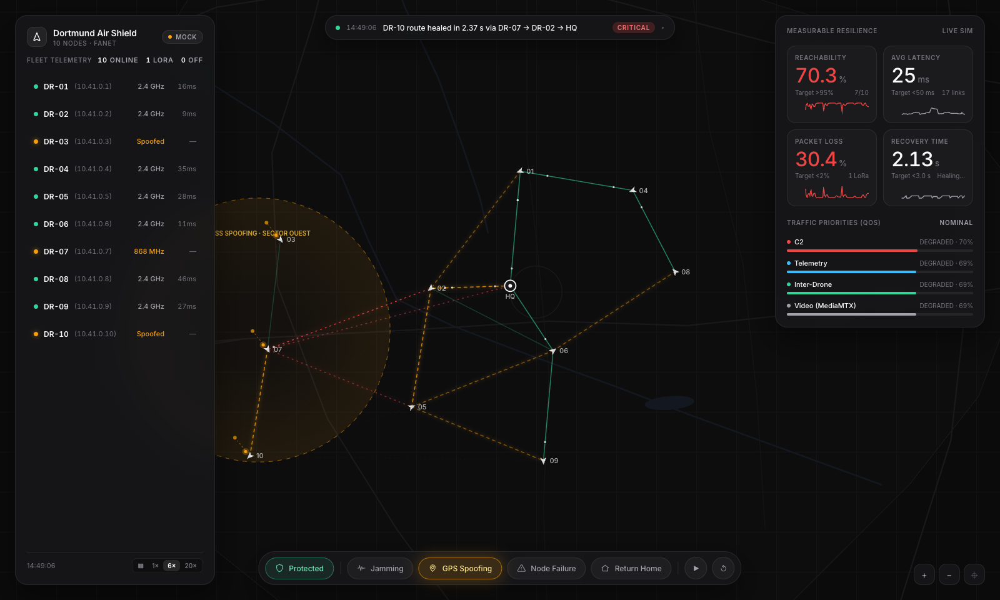 | 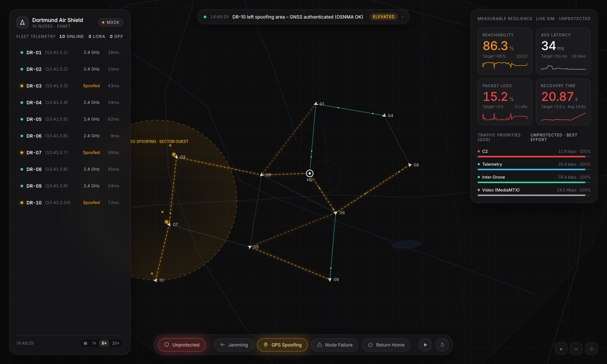 |
| The ghosts drift away. The chevrons keep flying the real orbit | The autopilot follows the ghost, so the drones are pulled off their orbits |

| | Protected | Unprotected |
|---|---|---|
| Under 60 m | Badge says spoofed. The drone still flies its real orbit | The autopilot is already steering toward the fake fix |
| Past 60 m | Plausibility check against INS fails. GNSS is rejected. The chevron stays on the real track | The drone leaves its orbit. In the comparison run the worst drift was **122 m** and still growing |
| After you turn it off | The offset decays and the fix is trusted again | The drone has to fly back to the orbit it left |

### Node failure — `F`

Two random drones die: heartbeat timeout, power-bus fault. They stop, descend, and reboot themselves after 20 s. This is a different event from falling off the network — the node is actually offline, not just unreachable.

Everyone who was routing through them loses that hop. Protected, Dijkstra installs a new route. The wait is about **450 ms + 220 ms per hop**, plus **900 ms** when the new path uses LoRa, plus up to 450 ms of jitter. That measured wait is the **Recovery Time** number. Unprotected, no new route is searched. Those drones stay broken until the dead relay finishes rebooting and the original hop exists again.

Losing DR-02 and DR-05 cuts the west group (DR-03, DR-07, DR-10) off from HQ completely. Each of them still has 2.4 GHz neighbours, so none of them is "jammed", but the group as a whole has no way home. Protection detects that partition and makes the group member closest to the rest of the network (here DR-03) open a LoRa bridge. The others route through it over 2.4 GHz.

| 0.7 s after the failure | 8 s later |
|---|---|
| 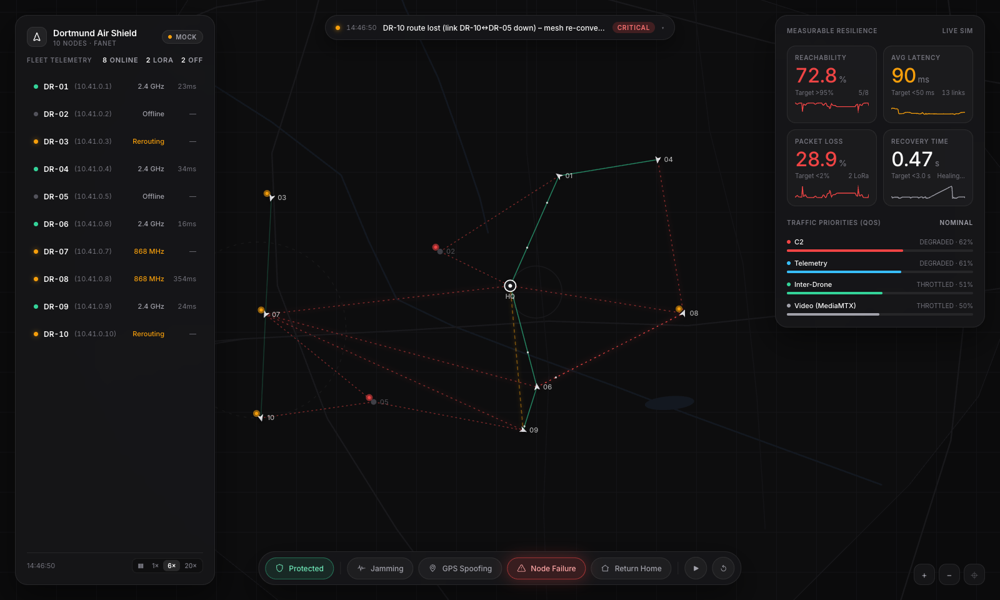 | 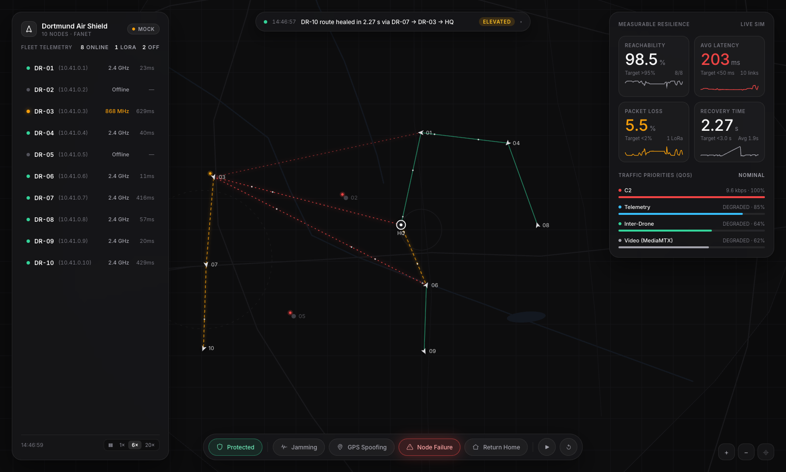 |
| Two relays down. The west group is rerouting and reachability drops | DR-03 opened 868 MHz to HQ. The whole group is back, with recovery time measured at about 2.5 s |

### Return home — `R`

The one response that waits for the operator. The mesh will not fly the fleet home by itself. Pressing it pulls every drone toward HQ, sheds video, and marks C2 as emergency (`EMERGENCY · C2 FIRST`). Press again and the fleet returns to its orbits.

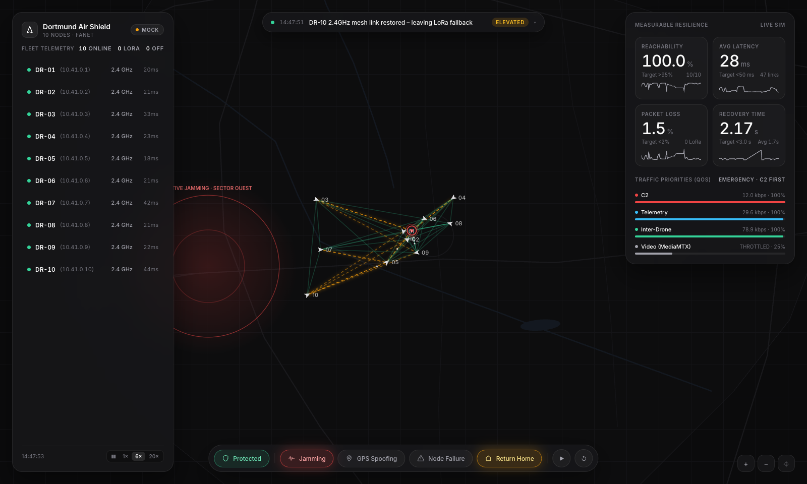

## When a drone falls off the network

Falling off means the drone is still airborne and still flying, and it has no usable path to HQ. Command-and-control, telemetry, inter-drone traffic and video from that drone all deliver nothing.

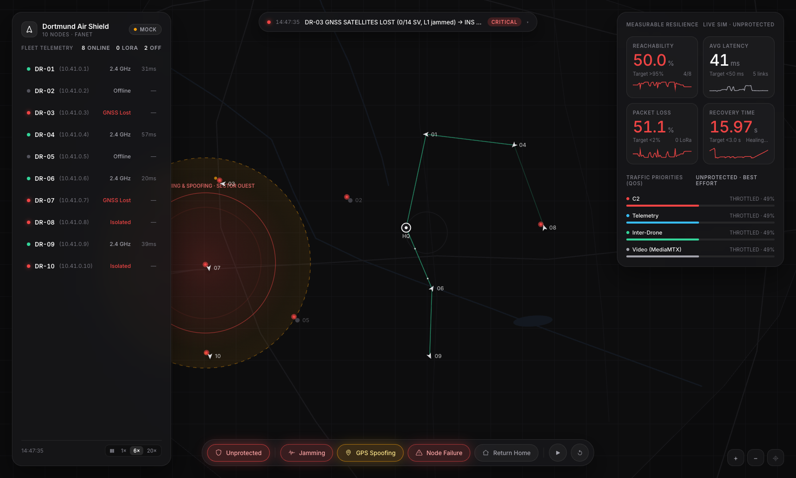

*Unprotected attack. The pulsing red dots without lines are drones that are still flying and have no path to HQ.*

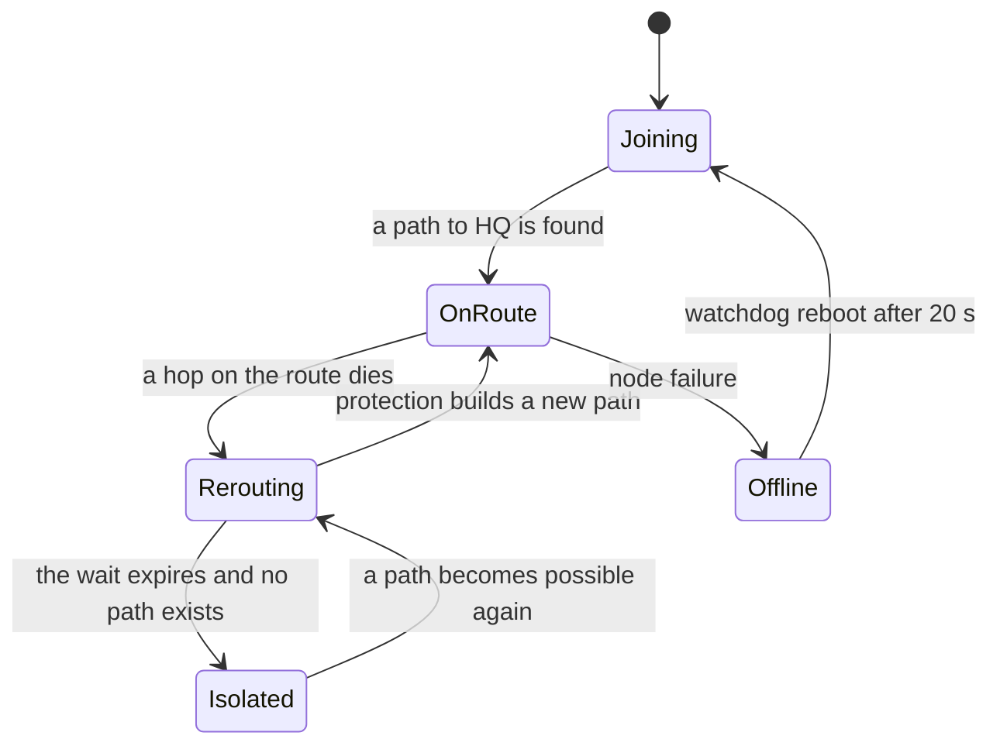

What you see, in order:

1. The 2.4 GHz lines disappear. With protection off, no red LoRa lines replace them. The log says all radios are lost.
2. For about a second the drone is **rerouting**, route empty, latency a dash.
3. The wait expires and the drone is **isolated**. A pulsing red dot replaces its links. The log calls this autonomous loiter. The flight code keeps the mission orbit — the drone does not stop and hover. With spoofing on and protection off, it keeps steering toward the fake fix and drifts further.
4. It still counts as online, so the fleet header does not move it to "Off". It counts as unreachable, so reachability falls and packet loss jumps. Its traffic is booked as demand and delivered as zero.
5. Average latency can look *healthier* after the drop. Only drones that still have a route are included in that average. Read reachability, not latency, when drones have gone isolated.

It comes back when a path to HQ exists again. Protected, that is the moment a LoRa or 2.4 GHz route appears, and the heal time is recorded. Unprotected, it happens only when the original links return — jamming turned off, or the failed relay rebooted. Switching the shield pill back to Protected during the attack pulls isolated drones in within a few seconds.

## How to read the four numbers

| Number | Nominal | What moves it |
|---|---|---|
| Reachability | target > 95 % | Share of online drones that currently have a route to HQ. One isolated drone ≈ −10 % |
| Avg latency | target < 50 ms | Round trip of the drones that still have a route. LoRa pushes this into the hundreds of ms. Isolated drones are left out |
| Packet loss | target < 2 % | Traffic that does not arrive. Isolated drones count as a total loss |
| Recovery time | target < 3 s | Seconds the mesh took to install a new route after one broke. While a heal is in progress it shows the wait so far |

White numbers are inside the target. Amber, then red, means the target has been crossed.

## Traffic priorities

Each drone's path is filled in strict order. C2 is about 1.2 kbps and is retried three times, so it stays near 100 % on a lossy link. Telemetry is about 3 kbps. Inter-drone is about 8 kbps. Video wants 2.5 Mbps.

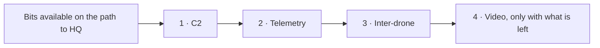

On LoRa the pipe is 5.5 kbps, so video is dropped and the first three still fit. During jamming or return-home, video that is still on 2.4 GHz is cut to a quarter. Unprotected, the order is removed: all four classes take a proportional share, video included, and C2 gets no retries.

## The same attack, both ways

Jamming, spoofing, and failure of DR-02 and DR-05 together, read about 9 s after the failures:

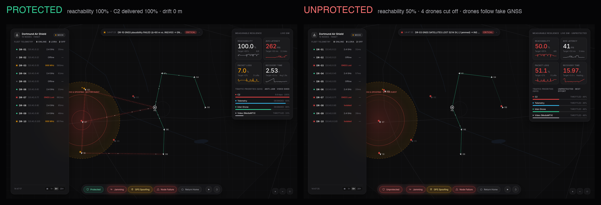

| | Protected | Unprotected |
|---|---|---|
| Reachability | 100 % | 50 % — four drones isolated |
| Avg latency | 262 ms, the LoRa paths | 41 ms, only the survivors |
| Packet loss | 7.0 % | 51.1 % |
| Recovery time | 2.5 s | 16 s and still waiting |
| C2 delivered | 100 % | 49 % |
| Video delivered | 15 %, shed on purpose | 49 %, competing with C2 |
| Furthest drone off its real track | 0 m | 122 m |

## The 70 second demo

`?demo=1` runs this on its own. Add `?protect=0` for the same script with the defenses off.

| Time | What happens |
|---|---|
| 0.5 s | Nominal mesh over Dortmund |
| 5 s | Jammer on in Sector Ouest |
| 16 s | Spoofer joins the jammer |
| 28 s | Two relay drones fail |
| 42 s | Operator sends return home |
| 62 s | Threat cleared, fleet back on mission |
| 70 s | Scenario ends |

## Backend integration

```bash
pip install websockets
python backend/mock_backend.py
# open index.html?ws=ws://localhost:8765
```

`backend/mock_backend.py` streams positions at 2 Hz. Replace `telemetry()` with real data. The dashboard also accepts a REST poll. Click the **MOCK** pill in the header to reveal the WebSocket field.

Data from the backend is authoritative for 5 s per drone. After that the built-in simulation takes over again, so a partial feed works: positions only, for example.

### Backend → dashboard

```jsonc
{"type": "drones", "data": [{"id": "DR-07", "lat": 51.505, "lon": 7.37, "alt": 95, "battery": 81,
                             "status": "ONLINE|OFFLINE|RTH", "gnss": "OK|LOST|SPOOFED", "band": "2.4GHz|868MHz"}]}
{"type": "event",   "data": {"type": "JAMMING|SPOOFING|NODE_FAILURE|NODE_RESTORE|RTH|PROTECTION|ZONE|RESET",
                             "active": true, "lat": 51.505, "lon": 7.365, "radius_m": 2200, "ids": ["DR-04"]}}
{"type": "metrics", "data": {"reachability": 97.2, "latency_ms": 23, "packet_loss": 1.1, "recovery_s": 1.4}}
{"type": "links",   "data": [{"a": "DR-01", "b": "HQ", "band": "2.4GHz", "quality": 0.82}]}
{"type": "log",     "data": {"level": "INFO|OK|WARN|CRIT|NET", "msg": "text"}}
{"type": "state_request"}
```

A bare array of drones, or a single drone object with an `id`, is also accepted. Unknown drone IDs are added to the fleet automatically. `PROTECTION` with `"active": false` is the same switch as the shield pill.

### Dashboard → backend

```jsonc
{"type": "hello", "client": "dortmund-air-shield", "version": "1.0.0", "fleet": ["DR-01", "..."]}
{"type": "command", "action": "SET_JAMMING|SET_SPOOFING|FORCE_NODE_FAILURE|SAFE_RETURN_HOME|SET_PROTECTION|MOVE_ZONE|RESET", "value": true, "ts": 0}
{"type": "state", "data": { /* full snapshot, reply to state_request */ }}
```

### JavaScript API

```js
window.updateDroneData([{ id: 'DR-07', lat: 51.505, lon: 7.37 }]);
AirShield.injectEvent({ type: 'JAMMING', active: true });
AirShield.injectEvent({ type: 'PROTECTION', active: false });
AirShield.updateMetrics({ reachability: 99 });
AirShield.updateLinks([{ a: 'DR-01', b: 'HQ', band: '868MHz', quality: 0.4 }]);
AirShield.connect('ws://localhost:8765');
AirShield.poll('http://localhost:5000/state', 1000);
AirShield.onCommand(cmd => console.log(cmd));
AirShield.getState();
```

## Simulation constants

| Constant | Value |
|---|---|
| Fleet | DR-01 … DR-10, plus HQ at 51.5150° N, 7.4560° E |
| Mesh addresses | `10.41.0.1` … `10.41.0.10` |
| Jam zone | 51.5050° N, 7.3650° E, radius 2 200 m, Sector Ouest |
| Jam fringe | full strength to the radius, zero at 1.35× |
| GNSS lost | jam strength above 0.55 |
| Spoof radius | 1.5× the jam zone, drift ~7 m/s |
| GNSS rejected | offset greater than 60 m against INS |
| LoRa opened | jam above 0.5, or no 2.4 GHz neighbor, up to 3 links; plus one bridge drone per group cut off from HQ |
| Rebuild wait | 450 ms + 220 ms/hop + 900 ms if the new path is LoRa |
| Failed node | back after 20 s |
| Network tick | every 200 ms |
